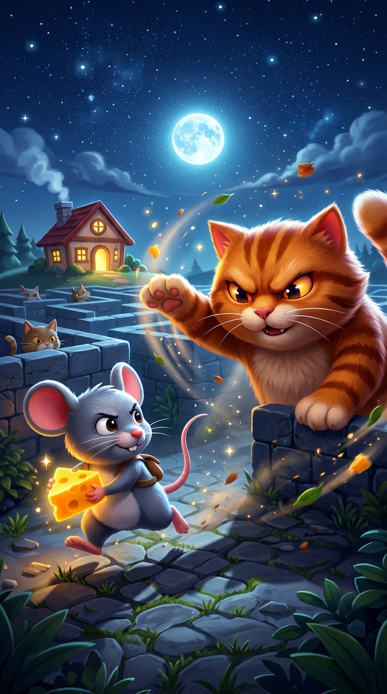
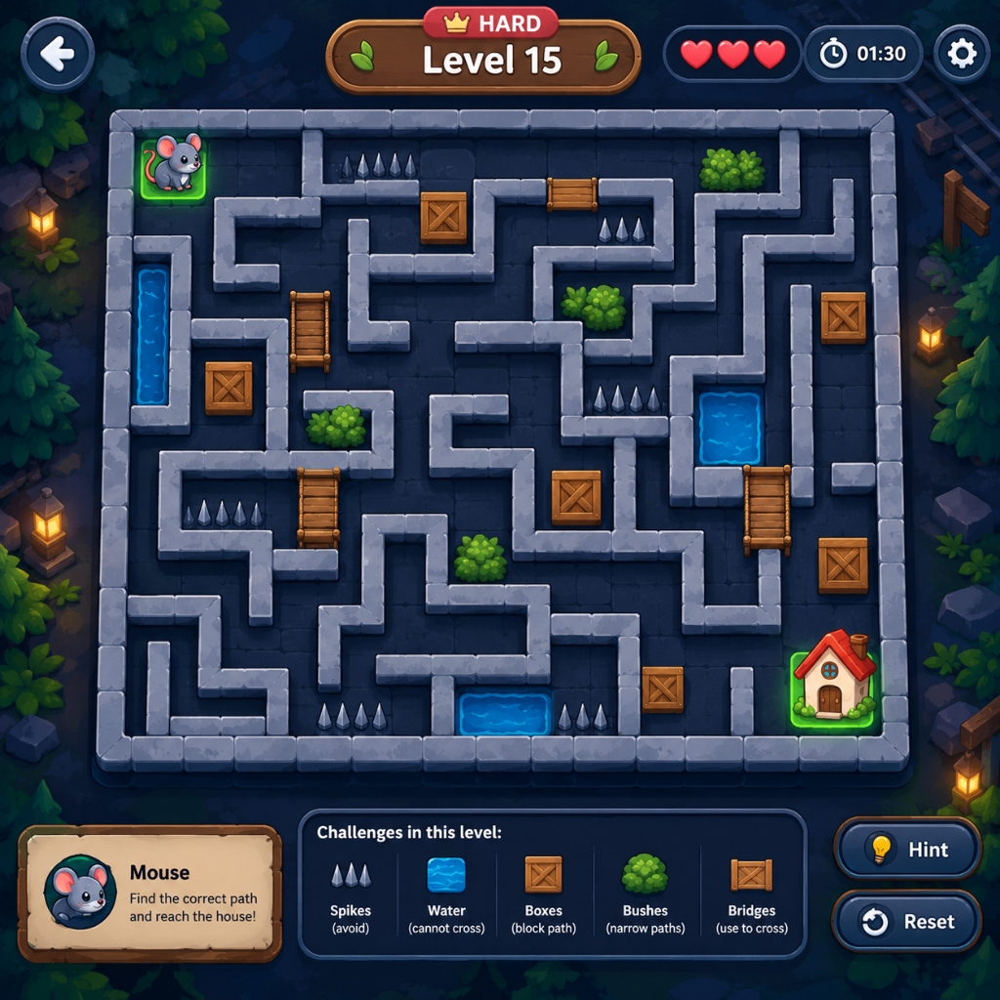

# 🐭 Mouse Stealth: 2D Puzzle Adventure

<p align="center">
  
</p>

<p align="center">
  <b>Sneak past patrolling cats, collect golden cheese, avoid traps, and guide the brave mouse home safely!</b>
</p>

<p align="center">
  
  
  
  
</p>

---

## 🎮 Overview

**Mouse Stealth** is an engaging 2D stealth puzzle game built with **Flutter** and **Flame Engine**. Players guide an adventurous mouse through dynamic mazes filled with patrolling cats, interactive environmental obstacles, secret cheese caches, and hazard traps.

Featuring **100 handcrafted & procedurally audited levels**, the game tests strategic timing, route planning, and stealth evasion across 10 distinct themed worlds.

---

## 📸 Screenshots

| 🎨 Key Art & Loading | 🗺️ Maze Gameplay & Obstacles |
| :---: | :---: |
|  |  |
| *Cinematic 3D Visual Art & Live Loader* | *Patrol Lines, Fog of War, Traps & Bridges* |

---

## ✨ Key Features

- 🧠 **Dynamic Cat AI**:
  - Full **360° situational vision radar** with field-of-view occlusion (walls break line-of-sight).
  - Smart state machine: **Patrol**, **Alert/Investigate**, **Chase**, and **Cooldown Return**.
- 🏰 **100 Levels Across 10 Worlds**:
  - Progressive difficulty with a smooth learning curve.
  - Interactive zigzag level selection map displaying star progress.
- 📦 **Interactive Obstacles & Hazards**:
  - **Spikes & Mouse Traps**: Dangerous hazards requiring careful timing.
  - **Water & Bridges**: Passable only using wooden bridges.
  - **Pushable Crates & Boulders**: Create paths or block cat patrol vision.
  - **Hiding Bushes**: Cloak the mouse from feline sight.
- 🧀 **Economy & Power-ups**:
  - Collect cheese wedges to spend in the in-game shop.
  - Power-ups: **Sneakers (Speed Boost)**, **Cardboard Box (Invisibility)**, and **Clock (Time Freeze)**.
- 👶 **Kid-Friendly Onboarding**:
  - Interactive animated glove pointer for on-the-board visual teaching.
  - Vibrant arcade-style age gate modal for initial setup.

---

## 🛠️ Tech Stack & Architecture

- **Framework**: [Flutter](https://flutter.dev) (Null-safe Dart)
- **Game Engine**: [Flame Engine](https://flame-engine.org)
- **Pathfinding & AI**: Breadth-First Search (BFS), Raycast Occlusion Line-of-Sight
- **State Management**: Reactive GameSessionState & Services (`ProgressService`, `CosmeticsService`)
- **Graphics**: Custom procedural vector renderers (`ProceduralPainter`) + hardware-accelerated Flame components

---

## 🚀 Getting Started

### Prerequisites

- [Flutter SDK](https://docs.flutter.dev/get-started/install) (`>=3.3.0`)
- Android Studio / VS Code with Flutter extension
- An emulator or physical Android/iOS device

### Installation

1. **Clone the repository**:
   ```bash
   git clone https://github.com/bscs1190-max/mouse-stealth.git
   cd mouse-stealth
   ```

2. **Install dependencies**:
   ```bash
   flutter pub get
   ```

3. **Run tests**:
   ```bash
   flutter test
   ```

4. **Launch the game**:
   ```bash
   flutter run
   ```

---

## 🧪 Verification & Testing

The project includes an automated test suite verifying AI behavior, pathfinding integrity, and puzzle solvability:

```bash
flutter test
flutter analyze
```

---

## 📜 License

This project is licensed under the MIT License.
